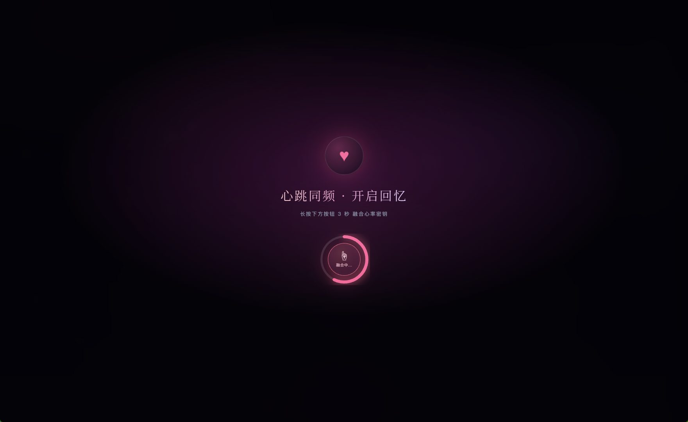
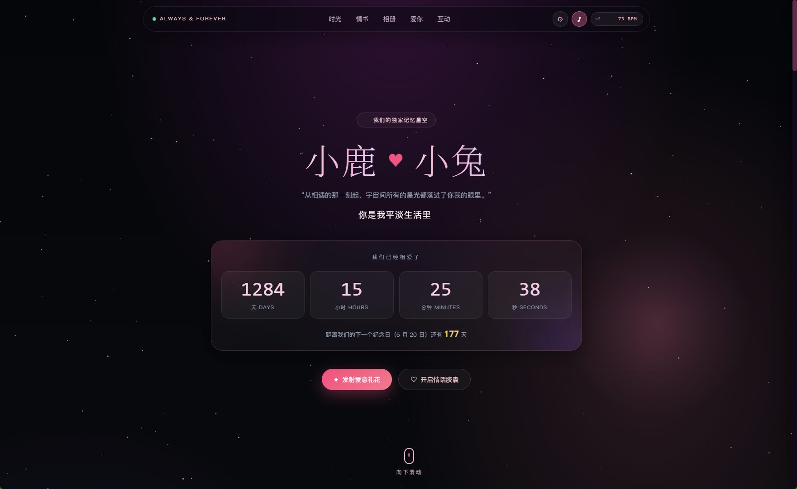
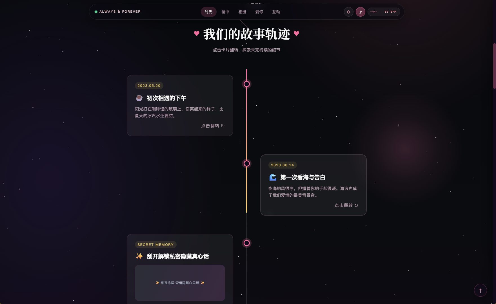
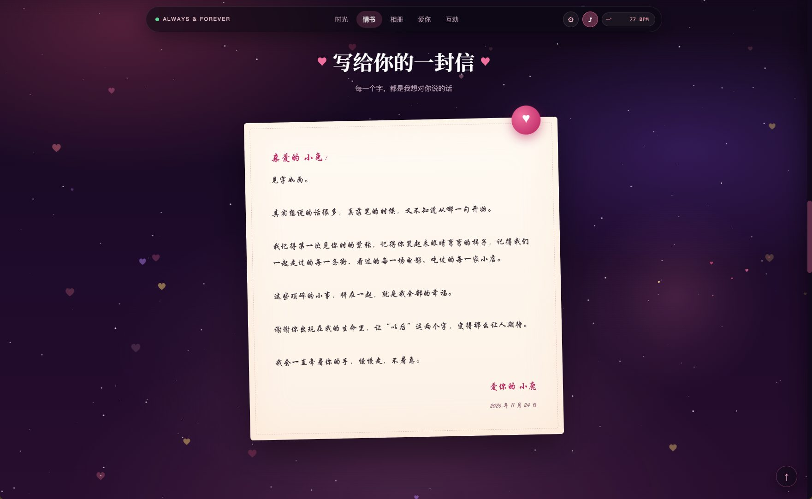
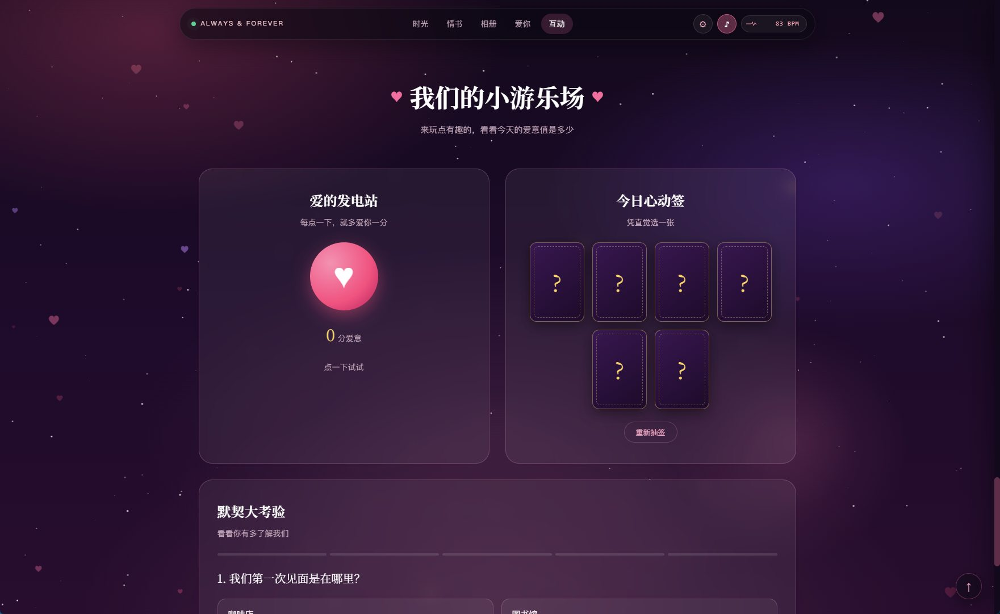
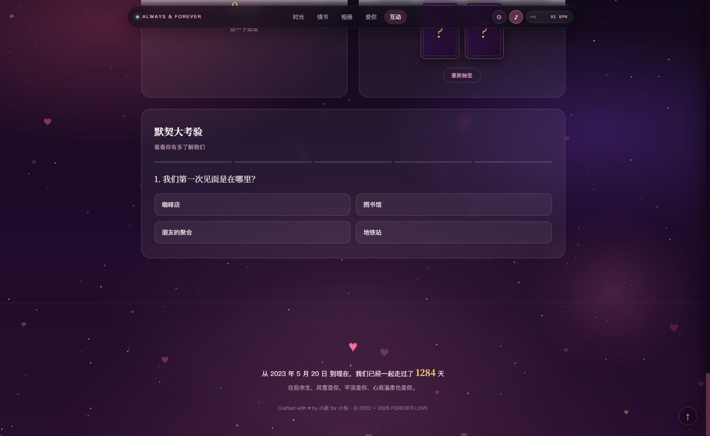

# Couple's Memorial · 我们的小宇宙

一个纯前端的情侣纪念单页网站：星空解锁开场、相爱计时、故事时间轴、情书、3D 照片立方体、爱你的理由与默契问答，所有文案与照片都能在页面里直接定制。

无构建步骤、无框架、无第三方 UI 依赖，直接用浏览器打开或部署到任意静态托管即可。

## 预览

| 开场解锁 | 星空首屏 |
| :---: | :---: |
|  |  |

| 故事轨迹 | 写给你的一封信 |
| :---: | :---: |
|  |  |

| 我们的瞬间（3D 立方体） | 爱你的理由 |
| :---: | :---: |
|  |  |

| 我们的小游乐场 | 默契大考验与页脚 |
| :---: | :---: |
|  |  |

> 截图为演示数据；相册的平铺→拼合、拖动旋转、悬停展开为实时交互，建议本地打开体验。

## 功能一览

- **开场解锁**：长按 3 秒，进度环填满后礼花绽放，进入主页面
- **星空首屏**：双方昵称、轮播文案、实时相爱计时（天/时/分/秒）、下一个纪念日倒计时、礼花与情话胶囊按钮
- **心率装饰**：右上角心电图线条 + 实时心率数字，随背景音乐播放跳动（68–92 BPM），暂停时定格
- **故事轨迹**：时间轴卡片，支持点击翻转查看背面私密文案，其中一张为刮刮乐
- **情书**：纸质信笺样式，滚动到视口后逐字打出
- **相册**：滚动到该区块先以 3 列 × 2 行平铺展示六张照片，3 秒后逐张飞入拼合成 3D 立方体；合成后自动三轴翻滚，可鼠标/手指拖动旋转，悬停时六面向外展开；立方体内部还有一颗同样使用六张照片的小立方体独立自转
- **爱你的理由**：8 张翻转卡片
- **互动区**：爱的发电站（点击累计爱意）、今日心动签（抽签翻牌）、默契大考验（5 道选择题）
- **其他**：右上角定制面板、背景音乐开关、回到顶部按钮、移动端适配、减少动态效果适配

## 目录结构

```
index.html           页面结构
css/style.css        全部样式（含 3D 立方体、定制面板）
js/main.js           配置、渲染与交互逻辑
images/              相册照片 photo1–photo6
audio/               背景音乐 shenfen.flac、UnderTree.flac
docs/screenshots/    README 预览截图
code_artifact.html   早期星空页原稿（当前未引用）
README.md
```

## 本地运行

直接双击 `index.html` 可查看大部分效果；涉及音频加载时建议起本地服务器：

```bash
python -m http.server 5173
```

访问 http://127.0.0.1:5173 。修改代码后按 Ctrl + F5 强制刷新，避免浏览器缓存。

## 内容定制

点击右上角齿轮（⚙）打开「定制我的页面」，修改后点「保存修改」立即生效，并写入浏览器 `localStorage`（键名 `ourLoveSettings_v1`）。

- **基本信息**：两个昵称、在一起的开始时间、纪念日月/日
- **文字内容**：首页轮播句子（每行一句）、情书正文
- **页面标题与说明**：各区块标题/副标题、情书的称呼与落款前缀
- **故事轨迹**：每张卡片的日期/标签、图标、标题、正文、翻转背面文案
- **相册**：每张照片的说明、emoji 占位、上传本地照片（自动压缩为 JPEG 后以 dataURL 保存）
- **爱你的理由**：图标、正面标题、背面文案
- **默契大考验**：题目、四个选项、正确答案
- **页脚**：一句话与版权行
- **背景音乐**：音频地址（本地相对路径或直链）

底部「恢复默认」会清空所有自定义内容并重新加载。

### 替换相册照片

把新图片放进 `images/`，保持文件名 `photo1`–`photo6`（第四张当前是 `photo4.webp`，也可以是 jpg/png），或修改 `js/main.js` 中 `CONFIG.photos` 里每项的 `src`。建议：单张不超过 1100px 长边、200KB 左右，立方体面会按正方形居中裁切显示。

## 背景音乐

- 默认曲目：`audio/shenfen.flac`（《身份》— 艾岩），约 27MB；仓库另附 `audio/UnderTree.flac`
- 解锁时自动尝试播放，文件缺失或不可播放时自动改用内置合成轻音乐
- 右上角 ♪ 点击为暂停/继续（保留播放进度）
- 更换方式：替换文件 / 修改 `js/main.js` 的 `CONFIG.bgmSrc` / 在定制面板填入新的音频地址

浏览器限制自动播放，因此音频会在「长按解锁」这次用户操作中开始播放。

## 部署

- **GitHub Pages**：仓库 Settings → Pages，Source 选择 `main` 分支根目录，保存后访问 `https://<用户名>.github.io/<仓库名>/`
- 任意静态托管（Vercel、Netlify、对象存储）直接上传 `index.html`、`css/`、`js/`、`images/`、`audio/` 即可，无需构建命令
- 注意 GitHub 单文件上限 100MB，音频替换时不要使用过大的无损文件

## 数据与限制

- 自定义内容保存在访问者自己的浏览器里，不会同步到服务器，换设备/换浏览器需要重新设置
- 清除浏览器站点数据或使用「恢复默认」后，将回到代码里的初始内容
- 相爱计时基于设备本地时钟，修改系统时间会影响显示
- 相册、心率等均已对 `prefers-reduced-motion` 做降级处理

## 常见问题

- **改了照片/文字没生效**：先 Ctrl + F5；仍不变则说明浏览器里有旧的自定义记录，⚙ →「恢复默认」或清除站点 `localStorage` 后刷新
- **没有音乐**：确认 `audio/shenfen.flac` 存在且路径正确；本地直接双击打开时部分浏览器会限制本地音频，建议用本地服务器预览
- **立方体没有小方块**：小方块在拼合完成后才淡入，外层照片为半透明以露出内部；若外层过于透明/不透明，可调整 `css/style.css` 中 `.photo-cube-stage.assembled .pc-photo` 的 `opacity`
