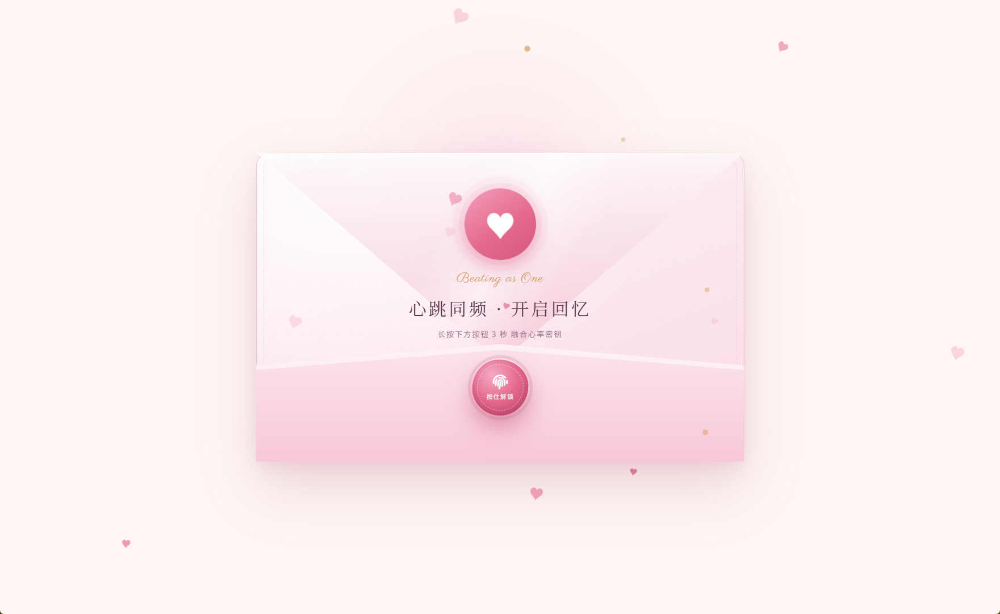
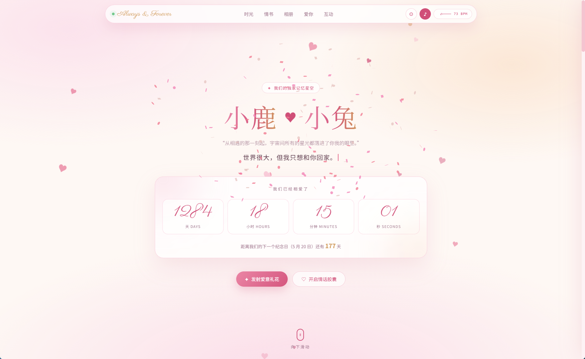

# Couple's Memorial · 爱的空间

「爱的空间」是一个纯前端的情侣纪念单页站点：信封长按解锁、星空首屏与相爱计时、故事时间轴、情书、3D 照片立方体、爱你的理由、爱的发电站、今日心动签与默契问答。整站采用奶油粉浅色主题，所有文案与照片都能在页面里直接定制。

无构建步骤、无框架、无第三方 UI 依赖，直接用浏览器打开或部署到任意静态托管即可。标签页标题默认「小鹿 & 小兔 · 爱的空间」，图标为粉色爱心。

## 预览

| 心跳解锁 · 信封 | 星空首屏 · 相爱计时 |
| :---: | :---: |
|  |  |

> 截图为演示数据；相册的平铺→拼合、拖动旋转、悬停展开为实时交互，建议本地打开体验。

## 功能一览

- **心跳解锁**：奶油粉信封 + 心跳印章，长按指纹按钮 3 秒，进度环填满后礼花绽放进入主页面
- **星空首屏**：双方昵称、轮播文案、实时相爱计时（天/时/分/秒，进入时数字依次弹跳）、下一个纪念日倒计时、礼花与情话胶囊按钮
- **心率装饰**：右上角心电图线条 + 实时心率数字，随背景音乐播放跳动（68–92 BPM），暂停时定格
- **故事轨迹**：时间轴卡片，支持点击翻转查看背面私密文案，其中一张为刮刮乐（刮开约 2/3 自动全部揭晓）
- **情书**：纸质信笺样式，滚动到视口后逐字打出
- **相册**：滚动到该区块先以 3 列 × 2 行平铺展示六张照片，3 秒后逐张飞入拼合成 3D 立方体；合成后自动三轴翻滚，可鼠标/手指拖动旋转，悬停时六面向外展开；立方体内部还有一颗同样使用六张照片的小立方体独立自转
- **爱你的理由**：8 张信笺风翻牌卡，带编号、圆形徽章、英文小标与分割线，最后一张「你的全部」为玫瑰色重点卡 + Forever 丝带；点击或悬停翻面查看文案
- **爱的发电站**：点击爱心累计爱意，附带等级进度条、今日点击 / 最高连击 / 爱意等级三项数据与流动心电图
- **今日心动签**：6 张签卡，点击后放大居中并直接翻面查看签文，右上角 ✕ 收回原位且保持翻面；签级（上上签 / 上签 / 中签…）与图标每次随机
- **默契大考验**：5 道选择题，即时判定对错并统计得分
- **视觉主题**：整站奶油粉浅色主题、漂浮爱心、导航与页脚手写体、深色星空 canvas 已停用以保证浅色观感
- **其他**：右上角定制面板、背景音乐开关、回到顶部按钮、移动端适配、减少动态效果适配

## 页面结构

1. **心跳解锁**：信封 + 心跳印章，长按指纹 3 秒进入
2. **星空首屏**：昵称标题、轮播文案、相爱计时、纪念日倒计时、礼花 / 情话胶囊
3. **我们的故事轨迹**：时间轴卡片，可翻面；其中一张是刮刮乐
4. **写给你的一封信**：纸质信笺 + 打字机
5. **我们的瞬间**：照片先平铺 3×2，再拼合成可拖动的 3D 立方体
6. **爱你的理由**：8 张信笺风翻牌卡
7. **我们的小游乐场**：爱的发电站、今日心动签、默契大考验
8. **页脚**：相爱天数、一句话、版权行，右下角回到顶部

## 目录结构

```
index.html           页面结构
css/style.css        全部样式（含 3D 立方体、定制面板）
js/main.js           配置、渲染与交互逻辑
images/              相册照片 photo1–photo6
audio/               背景音乐 UnderTree.flac（默认）、shenfen.flac
docs/screenshots/    预览图 unlock.png、hero.png
config-generator.html  批量配置工具（填表导出新 main.js）
serve.py              本地预览服务器
README.md
```

## 本地运行

涉及音频加载时建议起本地服务器：

```bash
py -3 serve.py          # 默认端口 5173；也可 py -3 serve.py 8080
```

> 本机的 `python` 指向 Python 2，务必用 `py -3`。

双击 `index.html` 也能看大部分效果，但音频可能受浏览器本地文件限制而失效，因此建议用上面的方式。

访问 http://127.0.0.1:5173 。修改代码后按 Ctrl + F5 强制刷新，避免浏览器缓存。

## 内容定制

点击右上角齿轮（⚙）打开「定制我的页面」，修改后点「保存修改」立即生效，并写入浏览器 `localStorage`（键名 `ourLoveSettings_v1`）。

- **基本信息**：两个昵称、在一起的开始时间、纪念日月/日
- **文字内容**：首页轮播句子（每行一句）、情书正文
- **页面标题与说明**：各区块标题/副标题、情书的称呼与落款前缀
- **故事轨迹**：每张卡片的日期/标签、图标、标题、正文、翻转背面文案
- **相册**：每张照片的说明、emoji 占位、上传本地照片（自动压缩为 JPEG 后以 dataURL 保存）
- **爱你的理由**：图标、正面标题、背面文案
- **默契大考验**：题目、四个选项、正确答案
- **页脚**：一句话与版权行
- **背景音乐**：音频地址（本地相对路径或直链）

> 今日心动签的 6 条签文暂未放进定制面板，可在 `js/main.js` 的 `CONFIG.fortunes` 中直接修改。

底部「恢复默认」会清空所有自定义内容并重新加载。

### 批量配置（让所有人看到同一份内容）

页面里的 ⚙ 面板只改当前浏览器（写 `localStorage`），不会同步给别人。若要让**每位访问者都看到你填的内容**，用配置生成器直接改代码默认值：

1. 用浏览器打开 `config-generator.html`
2. 可选：先点「加载现有 main.js」读入你已经改过的配置
3. 填表（基本信息、轮播、情书、相册路径、理由、签文、问答、回应语、BGM）
4. 点「导出 main.js」下载文件
5. 用下载的文件覆盖项目里的 `js/main.js`，然后 `git commit & push`

之后 GitHub Pages 自动更新，所有访问者看到的都是这份内容。注意：访问者浏览器里若已有旧的 `localStorage` 记录，仍会覆盖默认值，需在页面上点一次「恢复默认」清除。

> 照片只填**路径**（如 `images/photo1.jpg`），不要把图片内容贴进表单。扩展名支持 jpg / jpeg / png / webp / gif / avif / bmp，站点会自动探测实际文件。

### 替换相册照片

把新图片放进 `images/`，保持文件名 `photo1`–`photo6`（第四张当前是 `photo4.webp`，也可以是 jpg/png），或修改 `js/main.js` 中 `CONFIG.photos` 里每项的 `src`。建议：单张不超过 1100px 长边、200KB 左右，立方体面会按正方形居中裁切显示。

## 背景音乐

- 默认曲目：`audio/UnderTree.flac`（《山楂树之恋》— 程佳佳），约 41MB；仓库另附 `audio/shenfen.flac`（《身份》— 艾岩）
- 解锁时自动尝试播放，文件缺失或不可播放时自动改用内置合成轻音乐
- 右上角 ♪ 点击为暂停/继续（保留播放进度）
- 更换方式：替换文件 / 修改 `js/main.js` 的 `CONFIG.bgmSrc` / 在定制面板填入新的音频地址

浏览器限制自动播放，因此音频会在「长按解锁」这次用户操作中开始播放。

## 部署

- **GitHub Pages**：仓库 Settings → Pages，Source 选择 `main` 分支根目录，保存后访问 `https://<用户名>.github.io/<仓库名>/`
- 任意静态托管（Vercel、Netlify、对象存储）直接上传 `index.html`、`css/`、`js/`、`images/`、`audio/` 即可，无需构建命令
- 注意 GitHub 单文件上限 100MB，音频替换时不要使用过大的无损文件

## 数据与限制

- 自定义内容保存在访问者自己的浏览器里，不会同步到服务器，换设备/换浏览器需要重新设置
- 清除浏览器站点数据或使用「恢复默认」后，将回到代码里的初始内容
- 相爱计时基于设备本地时钟，修改系统时间会影响显示
- 相册、心率等均已对 `prefers-reduced-motion` 做降级处理

## 常见问题

- **改了照片/文字没生效**：先 Ctrl + F5；仍不变则说明浏览器里有旧的自定义记录，⚙ →「恢复默认」或清除站点 `localStorage` 后刷新
- **没有音乐**：确认 `audio/UnderTree.flac` 存在且路径正确；本地直接双击打开时部分浏览器会限制本地音频，建议用本地服务器预览
- **立方体没有小方块**：小方块在拼合完成后才淡入，外层照片为半透明以露出内部；若外层过于透明/不透明，可调整 `css/style.css` 中 `.photo-cube-stage.assembled .pc-photo` 的 `opacity`
- **心动签怎么收回**：点右上角 ✕、点空白处或按 Esc 都会收回；收回后原位那张牌保持翻开，点「重新抽签」才会全部盖回背面
- **签级和图标每次都不同**：签级（上上签 / 上签 / 中签…）和圆形图标是随机装饰，不影响签文内容
- **想改标签页标题 / 图标**：静态标题与爱心 favicon 在 `index.html` 顶部；运行时标题还会拼上双方昵称，在 `js/main.js` 的 `fillText()` 中设置

## 兼容性

- 目标为现代浏览器（Chrome / Edge / Safari / Firefox 最新版），依赖 CSS 3D、`clip-path`、`backdrop-filter` 等特性
- Google Fonts 与 FontAwesome 通过 CDN 加载；离线打开时会退化为系统字体、部分图标缺失，其余功能不受影响
